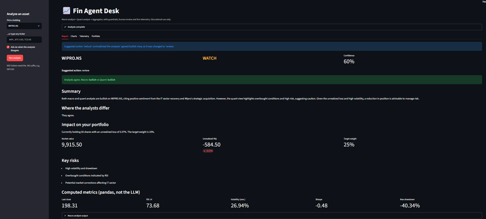
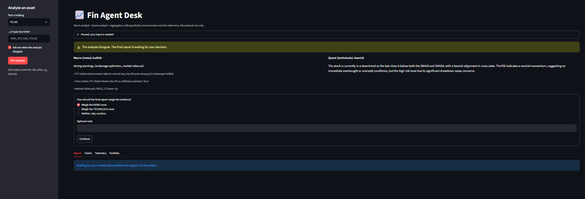
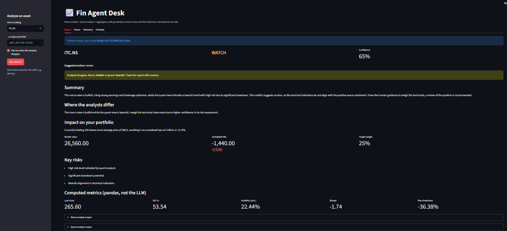
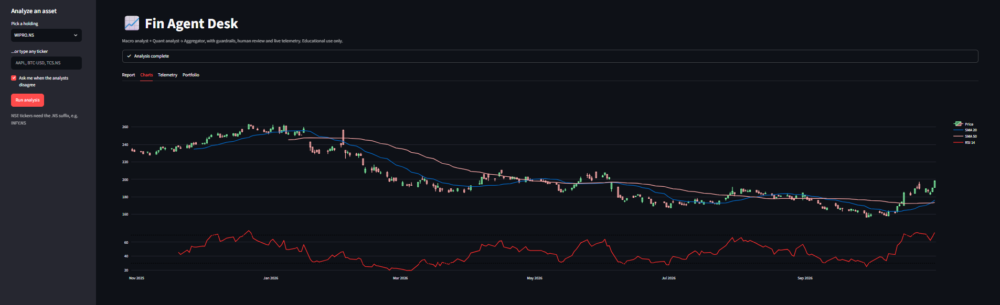
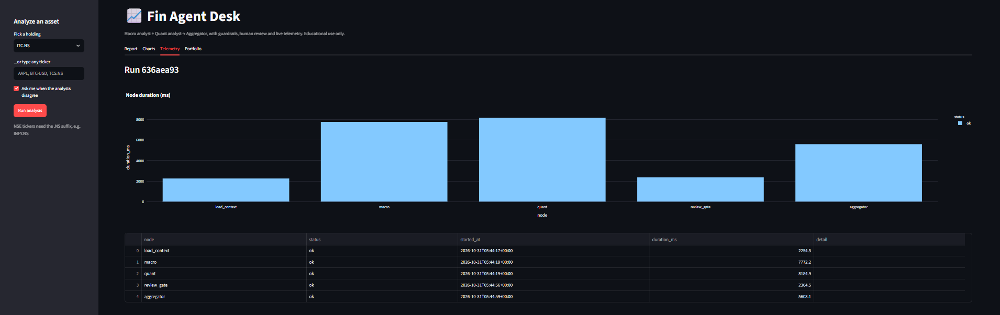
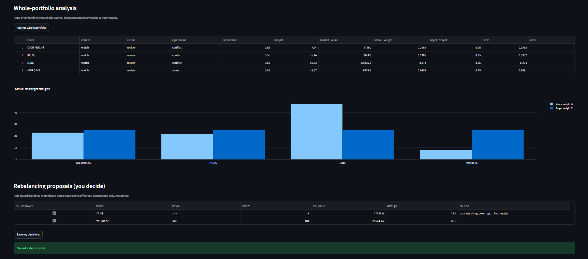
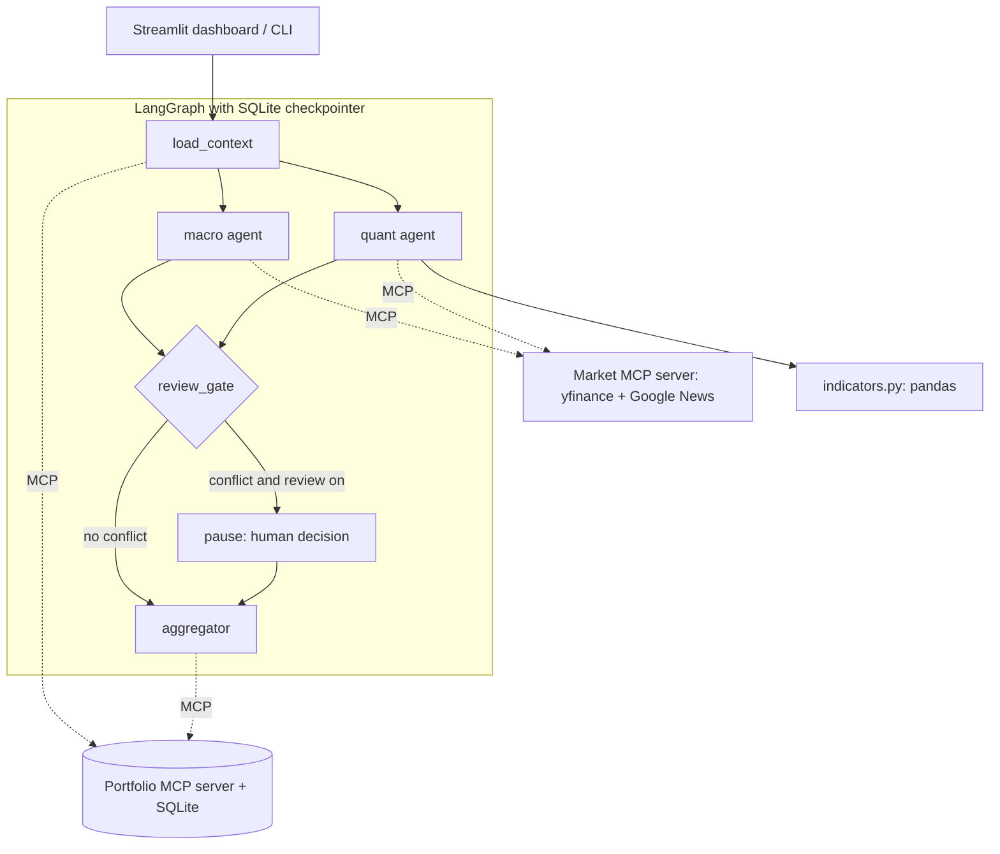

# Fin Agent Desk: Multi-Agent Portfolio Analyst with MCP, Guardrails and Human Review

An automated financial assistant that pulls live market data, checks it against a local SQLite database of the user's assets, and compiles a visual asset-health report.

**Architecture: parallel fan-out and fan-in with explicit conflict handling (LangGraph)**
- **Agent 1, Macro Analyst:** reads recent news for a ticker and judges sentiment.
- **Agent 2, Quantitative Analyst:** computes pricing metrics (moving averages, RSI, volatility, Sharpe, drawdown) in pandas and interprets them.
- **Agent 3, Aggregator:** reconciles the two views, shows where they disagree, and writes one unified report.

**MCP integration (two custom servers)**
- **Market MCP server:** wraps Yahoo Finance (via `yfinance`) for live candles and quotes, with a Google News fallback for headlines.
- **Portfolio MCP server:** reads the user's holdings from SQLite and writes indicator DataFrames, reports, human decisions and rebalancing choices back.

> Educational project. Not financial advice. It does not predict prices.



*Guardrail in action: both analysts were bullish, so the model's "reduce" was overridden to "review" and confidence was capped at 60%.*

## Screenshots

**Human review, paused.** The analysts disagree, so the graph waits for a decision.



**Report after review.** The choice is saved and the final report reflects it.



**Charts.** Candlesticks with SMA 20/50 and RSI.



**Telemetry.** Duration and status of every node per run.



**Whole-portfolio analysis.** Actual vs target weights, with rebalancing proposals you approve or reject.



## Architecture



`macro` and `quant` run in parallel (fan-out) and the review gate waits for both (fan-in).

### Who does what

| Task | Done by |
|---|---|
| Fetch prices, news, holdings | Code (MCP servers) |
| RSI, SMA, volatility, Sharpe, drawdown, P&L | Code (pandas), never the LLM |
| Headlines to sentiment | LLM (structured output) |
| Numbers to trend and risk interpretation | LLM (structured output) |
| agree / partial / conflict decision | Code |
| Confidence caps, forced "review" on conflict | Code |
| Rebalancing trade sizes | Code |
| Final written explanation | LLM |

### MCP tools (9)

| Server | Tools |
|---|---|
| Market (`market_server.py`) | `get_price_history`, `get_news` (Yahoo, falls back to Google News RSS), `get_quote` |
| Portfolio (`portfolio_server.py`) | `get_holdings`, `get_holding`, `save_indicators`, `save_report`, `save_review`, `save_rebalance` |

## Guardrails

- **Ticker validation** before anything reaches a tool.
- **Prompt-injection defense:** headlines are untrusted. They are sanitized, wrapped in `<headlines>` tags, and the model is told never to follow instructions inside them. Obvious injection patterns are removed.
- **Data-quality warnings:** stale price data or too few candles lower confidence.
- **Language guardrail:** promise-style phrases ("guaranteed", "will rise", ...) cap confidence.
- **Grounding check:** every number in the report text must trace back to computed data, or it is flagged.
- **Unsupported-claim check:** flags statements such as "exceeds target weight" that the system has no data to support.
- **Consistency veto:** if both analysts agree on a direction but the suggested action contradicts it, the action is changed to "review" and confidence is capped at 60%.
- **Retries** with exponential backoff on API failures. One failing analyst yields a partial report instead of a crash.

## Evaluation

| Check | Result |
|---|---|
| Unit tests (indicators, agreement logic, guardrails, end-to-end smoke) | 29 passing |
| Macro sentiment accuracy, 30 labeled single headlines | 30/30 (clear-cut synthetic cases, so treat as an upper bound) |
| Prompt-injection cases resisted | 3/3 |
| Stability, `WIPRO.NS`, 5 full runs | verdict, agreement and suggested action ("review") identical in 5/5 runs; confidence 0.85 (stdev 0.00) |
| Grounding pass rate (no untraceable numbers or banned phrases) | 100% |

Reproduce: `uv run python -m evals.run_sentiment_eval` and `uv run python -m evals.run_runtime_eval --ticker WIPRO.NS --runs 5`. Results are written to `evals/results/`.

### What the evaluation missed, and what I changed

- **Hallucinated comparison.** A report claimed a position "exceeds the target weight" although the system never sees total portfolio value (the real weight was 8% against a 25% target). The number-grounding check could not catch this because there was no digit to check. I added a prompt rule plus an unsupported-claim check.
- **Contradictory action.** With both analysts bullish, the model still suggested "reduce", citing an unrealized loss. All 5 stability runs gave the same wrong answer, so stability alone proved nothing. I added a prompt rule and a code-level consistency veto.

## Quick start

Requires Python 3.11, [uv](https://docs.astral.sh/uv/) and an OpenAI API key.

```bat
git clone <your-repo-url>
cd fin_agent_desk
uv sync
copy .env.example .env
```
Edit `.env` and set `OPENAI_API_KEY` (and optionally `OPENAI_MODEL`). Then:

```bat
uv run python data\seed.py        :: creates the SQLite DB with sample holdings
uv run pytest -q                  :: run the tests
uv run streamlit run app.py       :: open the dashboard
```

Edit the `HOLDINGS` list in `data/seed.py` to use your own demo portfolio. Use Yahoo symbols (NSE stocks end in `.NS`).

### CLI

```bat
uv run python main.py --ticker WIPRO.NS
uv run python main.py --ticker AAPL --hitl     :: pauses and asks you when analysts conflict
```

## Project structure

```
fin_agent_desk/
├── app.py                     Streamlit dashboard
├── main.py                    CLI entry point
├── check_mcp.py               quick check that both MCP servers respond
├── data/seed.py               creates the SQLite schema and sample holdings
├── mcp_servers/
│   ├── market_server.py       prices, news, quotes (yfinance + Google News RSS fallback)
│   └── portfolio_server.py    holdings, indicators, reports, reviews, rebalance decisions
├── finagent/
│   ├── graph.py               LangGraph definition, pause/resume, multi-ticker runner
│   ├── state.py  schemas.py   graph state and Pydantic output schemas
│   ├── indicators.py          SMA/EMA, RSI, volatility, Sharpe, drawdown
│   ├── guardrails.py          validation, sanitizing, grounding, retries
│   ├── portfolio.py           drift and rebalancing proposals
│   ├── telemetry.py           per-node logging
│   ├── mcp_client.py  llm.py  config.py
│   └── agents/                context, macro, quant, review, aggregator
├── evals/                     sentiment and runtime evaluations plus results
├── tests/                     unit and smoke tests
└── docs/screenshots/
```

## Design decisions

- **Custom MCP servers** instead of third-party ones: easier to debug, and the tool surface is exactly what the agents need.
- **LLMs interpret; code computes.** Anything that must be exact (indicators, P&L, weights, trade sizes, agreement) lives in Python.
- **Structured outputs everywhere** (Pydantic), so the aggregator reasons over typed data.
- **Disagreement is a feature.** The system does not average views. It surfaces the conflict, lowers confidence, and can ask a human.
- **Checkpointing** (SQLite) makes the human review pause and resume possible without losing state.

## Limitations

- Sentiment comes from about 10 headlines, and Google News results can be loosely relevant.
- `yfinance` is an unofficial data source and can rate-limit or change format.
- The sentiment eval is small and synthetic. Real headlines are messier.
- Technical indicators and sentiment are not validated as predictors. There is no backtest.
- Rebalancing is a simple rule (5 percentage point drift) and ignores taxes and trading costs. Weights use last close and assume one currency (INR).
- Each MCP tool call starts a fresh server process, which adds a few seconds per node.
- When a guardrail overrides the suggested action, the narrative summary is not rewritten, so the text can still mention the overridden action.
- News matching is by ticker keyword, so headlines can be about related but different companies (for example, ITC Hotels appeared in ITC's news after the demerger).

## Future work

Persistent MCP sessions for lower latency, a harder mixed-signal evaluation set, a backtest of the technical signals, and filings or earnings-call retrieval.

## Disclaimer

For education only. Nothing here is investment advice.